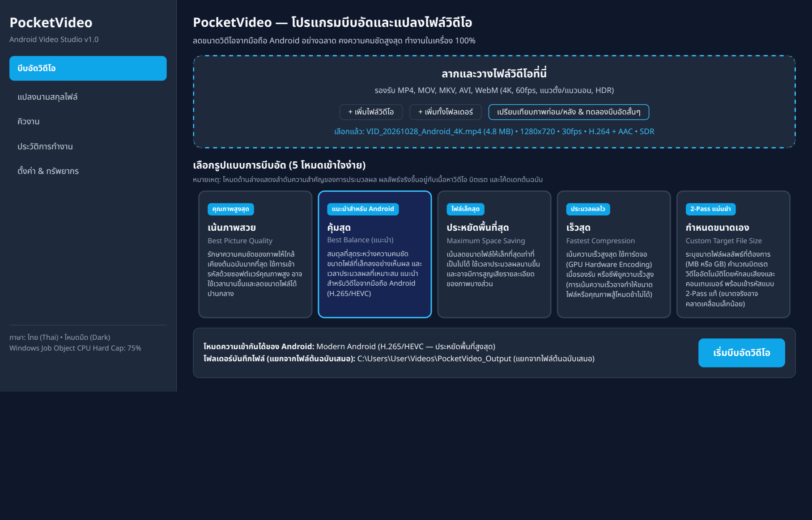
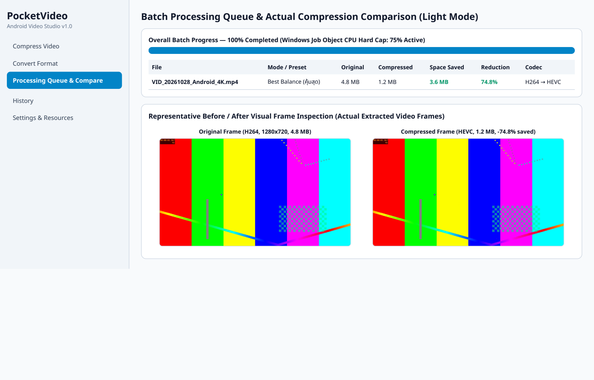

<!-- firm-impulse-showcase:v1 -->
<div align="center">

# 🎞️ PocketVideo

**Compress smarter. Keep your files local. A free offline media utility for Windows.**

   

[Features](#key-features) · [Releases](https://github.com/Apichetfirm/PocketVideo/releases) · [Source](https://github.com/Apichetfirm/PocketVideo)

<sub>Part of the Firm Impulse engineering portfolio.</sub>

</div>

---

**PocketVideo** is a free, open-source, 100% offline Windows 10/11 (x64) desktop application for converting and compressing mixed Android phone **videos and still photos**, including HEIC/HEIF when the bundled codec backend is present.

> **Release status (v1.2.0 development):** The GitHub Releases page still contains v1.0.0; newer source builds require Windows CI plus binary-codec redistribution review before publishing. Source/PR merge does not automatically certify an official installer.

> **Screenshot status:** The previews below were generated with a headless HTML renderer using actual FFmpeg test data. They illustrate the intended layout; they are **not** native Windows/PySide6 screenshots. Each Windows CI build also captures native Qt screenshots as a downloadable workflow artifact for review.





## Key Features

### 1. Five Simple Compression Modes (No Codec Jargon Required)
Default interface language is **Thai (`th`)** with one-click switching to **English (`en`)** and **Dark / Light** themes:

| Preset | Thai Name | English Name | Encoding Strategy & Priority |
| :--- | :--- | :--- | :--- |
| **Preset A** | **เน้นภาพสวย** | **Best Picture Quality** | Software CRF (`slow`, CRF 20 HEVC / 18 H.264) prioritizing visual fidelity. |
| **Preset B (Default)** | **คุ้มสุด** | **Best Balance** | Software CRF (`medium`, CRF 24 HEVC / 22 H.264) recommended for Android phone videos. |
| **Preset C** | **ประหยัดพื้นที่สุด** | **Maximum Space Saving** | High-density CRF (`slow`, CRF 29 HEVC / 27 H.264) with visual degradation warnings. |
| **Preset D** | **เร็วสุด** | **Fastest Compression** | Hardware GPU encoding (`NVENC`, `QSV`, `AMF`) with automatic fast CPU fallback (`veryfast`). |
| **Preset E** | **กำหนดขนาดเอง** | **Custom Target File Size** | Genuine **two-pass** software encoding (`libx264` / `libx265`) targeting user-specified MB/GB after reserving audio, subtitles, and container overhead. |

> **Important**: Presets describe encoding priorities rather than guaranteed percentage reductions. Actual savings depend on source motion complexity, codec, and bitrate. PocketVideo never mixes conflicting CRF and two-pass bitrate flags.

### 2. Android Phone Video Optimization
- **Intelligent FFprobe Inspection**: Detects MP4/MOV/MKV/AVI/WebM containers, H.264/AVC, H.265/HEVC, VP9, AV1, 4K resolution, 30/60 FPS, Variable Frame Rate (`-fps_mode vfr`), portrait/landscape rotation metadata, 8-bit/10-bit pixel formats, and Android device tags (`com.android.manufacturer`, `com.android.model`).
- **Two Compatibility Modes**:
  1. **Modern Android**: Prioritizes H.265/HEVC (`hvc1` tag) for maximum storage savings on modern devices.
  2. **Maximum Compatibility**: Prioritizes H.264/AAC in MP4 (`+faststart`) for universal playback.
- **HDR10, HLG & Dolby Vision Safety**:
  - Preserves 10-bit `yuv420p10le` and `bt2020` / `smpte2084` / `arib-std-b67` color transfer characteristics when supported.
  - Never silently converts HDR to SDR without warning.
  - Detects **Dolby Vision** (`dovi` configuration record / `dvhe` / `dvh1`) and explicitly warns that re-encoding cannot guarantee proprietary Dolby Vision RPU preservation, offering HDR10 fallback or lossless stream copy.
- **Already-Efficient Detection**: Calculates source bits-per-pixel-per-frame (`bpp`) and warns when recompressing an already tightly encoded video offers minimal benefit.

### 3. Smart Lossless Remux vs. Full Transcoding
- Supports **MP4**, **MOV**, **MKV**, **AVI**, and **WebM**.
- **Smart Remux (`-c:v copy -c:a copy`)**: When existing video/audio streams are natively compatible with the target container, PocketVideo changes the container in seconds with zero quality loss.
- Clearly distinguishes **Fast Lossless Smart Remux**, **Full Transcoding**, and **Compression with Re-encoding**.

### 4. Genuine Windows Resource Management (`Job Objects`)
- **Simple Modes**: **Light** (40% CPU cap, `IDLE` priority), **Balanced** (75% CPU cap, `BELOW_NORMAL` priority), and **Maximum** (100% uncapped, `NORMAL` priority).
- **Enforceable Windows CPU Hard Cap**: Uses Win32 `CreateJobObjectW` and `SetInformationJobObject` with `JobObjectCpuRateControlInformation` (`JOB_OBJECT_CPU_RATE_CONTROL_ENABLE | JOB_OBJECT_CPU_RATE_CONTROL_HARD_CAP`) to enforce a true kernel-level CPU percentage limit on child `ffmpeg.exe` processes.
- **Honest Resource Controls**: Clearly distinguishes kernel-enforced hard limits (Windows Job Object CPU Rate Control) from best-effort controls (FFmpeg `-threads`, CPU affinity mask, GPU encoder selection, and queue concurrency).

### 5. Safety, Reliability & Visual Comparison
- **Safe Export Policies**: Default **Keep Both** never overwrites input or output files. Opt-in **Replace Existing Output** and **Replace Original** retain the replaced file as a uniquely named `.pocketvideo_backup_*` backup and only promote a verified temporary output. A source-file identity/fingerprint check helps prevent accidental replacement if a USB/HDD disconnects or its file changes.
- **Before/After Visual Comparison & Sample Preview**: Extracts representative video frames and generates a 2.5-second compressed sample clip so you can inspect fine detail before encoding a multi-gigabyte video.

## Installation (Windows 10/11 x64)

1. **Installer (`PocketVideo-Setup-1.0.0-win64.exe`)**:
   Download the installer from the GitHub Releases page, verify its SHA-256 hash against `SHA256SUMS.txt`, and run the setup wizard. `ffmpeg.exe` and `ffprobe.exe` are bundled inside—no external installation or internet connection is required.
2. **Portable Package (`PocketVideo-1.0.0-win64-portable.zip`)**:
   Extract the ZIP archive anywhere on your computer and run `PocketVideo.exe`.

## Reproducible Build Instructions (From Source)

### Prerequisites (Windows 10/11 x64)
- Python 3.12+
- Git
- Optional: [Inno Setup 6](https://jrsoftware.org/isinfo.php) (`iscc.exe` in `PATH` to compile the `.exe` installer)

### Step-by-Step Build
```powershell
git clone https://github.com/Apichetfirm/PocketVideo.git
cd PocketVideo

# 1. Create virtual environment and install dependencies
python -m venv .venv
.\.venv\Scripts\Activate.ps1
pip install -r requirements-dev.txt
pip install -e .

# 2. Run the automated build, test, FFmpeg SHA-256 verification, and packaging script
.\packaging\build_windows.ps1
```

All build outputs (`PocketVideo-Setup-1.0.0-win64.exe`, `PocketVideo-1.0.0-win64-portable.zip`, and `SHA256SUMS.txt`) are placed in `dist\release\`.

## Running Automated Tests
```bash
PYTHONPATH=src python3 -m unittest discover -s tests -v
```

## Documentation
- [User Guide (Thai & English)](docs/USER_GUIDE.md)
- [Technical Architecture](docs/ARCHITECTURE.md)
- [Third-Party License Notices](THIRD_PARTY_NOTICES.md)
- [Release Notes](RELEASE_NOTES.md)

## License
PocketVideo is free and open-source software licensed under the **GNU General Public License v3.0 or later (`GPL-3.0-or-later`)**. See [LICENSE](LICENSE) and [THIRD_PARTY_NOTICES.md](THIRD_PARTY_NOTICES.md) for full details.

## v1.1.0: Mixed Photo + Video Export & Safe Storage

- Drag-and-drop entire folders containing MP4/MOV/MKV, JPEG/JPG, PNG, WebP, AVIF and HEIC/HEIF images. The app inspects each file, shows thumbnails, and adds **both image and video jobs to one queue**.
- **Video options** remain independent of **image output profiles** (Best Picture / Balanced / Smallest / Fastest / Custom Quality) with output formats JPEG/PNG/WebP/HEIC/AVIF; photo export does not pretend to use video two-pass encoding.
- HEIC/HEIF encode/decode uses `pillow-heif==1.8.1` (bundled libheif codec). Unsupported encoders fail with clear messages. AVIF availability depends on the installed Pillow/libheif build.
- Configure filename **suffix**, a **persistent default output folder**, and a collision policy: **Keep Both (default)**, **Skip Existing**, **Replace Destination with Backup**, or **Replace Original with Backup**. Replacing the original requires the **same file format** and extra user confirmation.
- Source data is preserved when an export fails. The queue halts new work when a source or destination USB/HDD disappears; reconnect and press **Retry Failed**. The saved original is not automatically deleted. An unplug during an atomic file replacement can still require manual recovery from the `.pocketvideo_backup_*` file.
- Choose **Do Nothing (default)**, **Sleep**, or **Shut Down** after the entire queue is verified successfully. A confirmation before starting and a cancelable 30-second countdown protect against unintended power actions. Failed/canceled jobs prevent triggering.
- The Windows **CPU Job Object Hard Cap** applies to subprocesses such as **FFmpeg video encoding**. Image encoding uses Pillow in-process and is **not** currently covered by that hard cap. GPU percentages are not hard caps.
- Safe backups can consume as much or more storage as the original until the user checks the exported result and deletes backups manually.
- Original filename suffix and export settings are persisted per user. **Power actions never run from the CLI.**

### Third-party codec obligations
`pillow-heif` binaries include codecs whose license terms may differ from the source package (including GPL and LGPL components); see `THIRD_PARTY_NOTICES.md` and upstream `LICENSES_bundled.txt`. Distributors must confirm binary/source license obligations and applicable HEVC patents before redistributing modified bundles. This is not a claim that all HEIC licensing requirements have been cleared.


## Creator credit

**Created by Firm Impulse.** PocketVideo is free and open source. Contributions and third-party library attribution remain acknowledged under the applicable license files and third-party notices.

## v1.1.1 — Clean UI and synchronized video preview (development)

- **Real synchronized Before/After video players:** both source and encoded output are playable together with one Play/Pause/Seek timeline. Videos are muted by default to avoid echo. The before-export sample preview is a temporary encoded clip; original playback seeks to the same source segment.
- **Zoom inspection:** open a compact floating detail window at the selected playback timestamp; FFmpeg extracts same-timestamp frames from the actual source/output, and both panes support 100–500% zoom and drag-to-pan.
- **Open file:** a menu offers **Before (original/backup)** and **After (output)** individually. **File location** selects the *output file itself* in Windows Explorer, instead of merely opening the directory.
- **Simpler dark/light UI:** removes unintended label background bands; consolidates the duplicated conversion navigation; reduces dashboard copy and imported-file table overflow. The existing five compression presets and image/video batch settings remain available.
- **Compatibility:** Qt Multimedia supplies video playback. Codec support can vary with Windows/Qt codecs; if a source cannot be played, the app explains the error rather than claiming a successful comparison. FFmpeg frame inspection remains available for zoom.
- v1.1.0 public binaries are not retroactively updated merely by merging; install a verified v1.1.1 Windows CI artifact when available. Review codec redistribution obligations before creating a new public release.

## v1.2.0 — Reliability and Quality (development)

- **Crash-resilient queue journal:** pending/in-progress jobs are saved locally, restored as *failed/interrupted*, and never run automatically after restart. Click **Retry Failed** after reconnecting and verifying source and destination disks. Completed results remain in History. The journal is not a guarantee of automatic recovery from filesystem corruption.
- **USB/HDD interruption:** sample source and destination availability during video/image encoding; preserve the original and stop scheduling new jobs on storage failure. A source fingerprint is validated again before final promotion. File data is flushed before replacing any destination, and backups are retained for opt-in overwrite.
- **Image CPU hard cap:** Pillow/HEIC encoding now runs in a separate child process that can be attached to Windows Job Objects. This also permits cancellation of an active image encode; import-time thumbnails and metadata decoding are not capped.
- **Skip growing output (optional):** Enable in additional Export settings. For compression operations, if encoded output is not smaller, it is discarded and the original remains intact. Explicit format conversion is not blocked. Disabled by default because quality-priority encodes may legitimately grow.
- **Nonblocking import:** Media inspection runs in background threads, so importing large folders does not freeze the desktop event loop.
- **SSIM / VMAF when available:** The Before/After video player can compare a bounded 6-second, 640x360, 8fps sample. This is diagnostic rather than full-duration scoring, and VMAF requires `libvmaf` in FFmpeg.
- **Queue cleanup:** Fixes stale Action-column index when results disappear.
- **Release compliance:** Public GitHub Release publishing is gated behind `POCKETVIDEO_RELEASE_APPROVED=true` repository Actions variable and a manual checklist in `docs/DISTRIBUTION_COMPLIANCE.md`. A green CI build does not settle rights/patents.


## v1.3.0 — Queue and GPU usability (source development)
- The processing queue shows **File Name, Started, Finished, Status, Progress %, FPS/Speed, Result, Destination, Actions** by default. The Job ID is hidden but can be enabled via **Choose columns**. Column visibility, widths, order and sidebar width are saved to user preferences.
- Each queued/running job has direct **Source** and **Output** folder shortcuts (if its directory exists); completed jobs add Before/After open and synchronized comparison in a compact menu.
- Result is **green when space is saved**, **red when output is larger**, and neutral for equal sizes. Canceled or failed jobs can be retried individually.
- GPU acceleration supports **NVIDIA NVENC, Intel QSV, AMD AMF, Apple VideoToolbox (macOS)** when the FFmpeg build advertises the encoder and a real probe encode succeeds; if unavailable, falls back to CPU. GPU encoding does not guarantee smaller files, better quality or a percentage GPU cap.
- Resource settings use compact labels and platform-specific limitations: Windows Job Object hard CPU cap is **Windows only**; macOS uses best-effort CPU threads/priority.

### macOS alpha
- A **macOS CI packaging workflow** begins a native .app alpha for testing using Python 3.12, PySide6, Pillow/HEIC and FFmpeg. The macOS app uses ~/Library/Application Support/PocketVideo and ~/Movies/PocketVideo_Output, Finder 'Reveal', and can probe VideoToolbox.
- The macOS alpha is **not signed with an Apple Developer ID, notarized, or validated on real Apple Silicon and Intel Macs**. macOS sleep/shutdown are deliberately disabled; Windows-only CPU hard caps do not work on macOS. Do not treat a green macOS CI as public macOS release approval. See docs/MACOS_ALPHA.md.


## v1.3.1 — Native icon polish and macOS readiness (development)
- Original PocketVideo app/installer icons are generated from source in `packaging/generate_icons.py`; navigation, file import, processing and queue actions now use small, native Qt icons with accessible text.
- Both Windows and macOS CI build branded desktop executables. macOS CI runs **Apple Silicon (arm64)** and **Intel (x86_64)** separately, checks the app signature and runs packaged CLI compression with external FFmpeg removed from `PATH` to reduce false-positive smoke tests.
- The macOS release workflow can perform Developer ID signing, hardened runtime, Apple `notarytool` notarization, stapling, and unsigned/signed artifact separation **only when the owner's Developer ID credentials and repository approval gates are configured**. This is not a claim of notarization or public release.
- Binary redistribution and physical end-user Mac tests remain explicit go/no-go gates. See `docs/MACOS_DISTRIBUTION.md`.


## v1.3.4 — HEVC 2-Pass Windows Hotfix (development)

- Windows libx265 two-pass statistics now use FFmpeg `-passlogfile`, avoiding invalid `C:` values in x265 colon-delimited options. Both passes are exercised in regression tests. No public release is created automatically.

## v1.3.3 — Compression Review (development)

This update fixes the completion callback bug that previously prevented saving some successful exports. Lifetime stats now persist across cleared history and removed originals. Previously unsaved jobs cannot be reconstructed without additional evidence.

In History/Queue, the percentage now means **output size remaining** (≈20% when the compressed file is one fifth of the source). In Maximum Space Saving the optional **2-Pass** checkbox switches from CRF to a bitrate target near half the source video bitrate; it may be slower and size/quality are not guaranteed.

Finished verified exports gain per-file and bulk **Move Original to OS Trash/Recycle Bin** actions with explicit confirmation and identity safety checks. They do not auto-delete, and emptying Trash is required to reclaim free disk space. Clear Finished Jobs affects queue entries only; Clear History removes visible history only. Concurrent Jobs supports **1–8**, settings ignore accidental mouse-wheel changes, and Light Mode highlights the active preset.

Windows Date Created is restored where supported; access/modified times are copied where filesystems permit. Timestamp failures are displayed as warnings instead of losing completed exports.

## v1.3.2 — Custom CPU limits and lifetime savings (development)
- Windows **CPU Hard Cap** now offers 10%, 20%, 30%, 40%, 50%, 60%, 70%, 75%, 80%, 85%, 90%, 95%, 100% plus **Custom 10–100%** (increments of 1%). The exact choice is saved and restored. macOS shows the control as unavailable because Windows Job Objects do not exist there.
- **FFmpeg Thread Count** has in-app help: `0 = Auto` is recommended; 4 threads requests a codec's worker threads, **not 4% CPU**, and an encoder may use other internal threads.
- The **History** screen reads metadata captured when exports completed, even if the source or output files were later deleted or an external drive is disconnected. One malformed historical row can no longer hide every other valid row.
- A separate `savings_stats.json` ledger persists **lifetime weighted net size reduction**, successful job count, and weighted percentage. It deduplicates by completed job ID and reconciles existing `history.json` automatically, while retaining totals after visible history is cleared or rotated. Missing original files never trigger recalculation or deletion of the snapshot.
- Copy an accurate text summary or branded **1200×630 share image** to the clipboard. Quote: **“พื้นที่มากขึ้น ชีวิตก็มีความเป็นไปได้มากขึ้น”** / “More space, more possibilities.”
- Important: this measures *before/after file-size difference*, not current *free disk space* if the original is still on disk. Negative net reduction is shown in red. Previously purged historical jobs cannot be reconstructed without their records.
