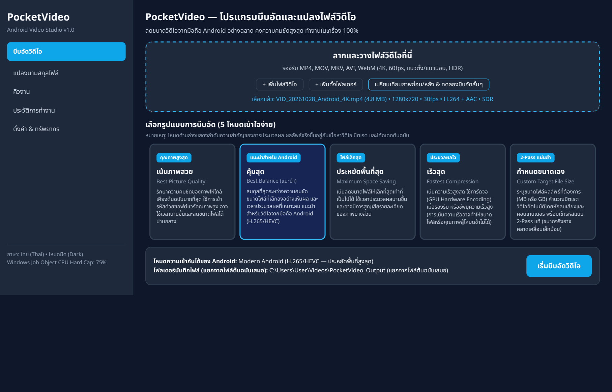
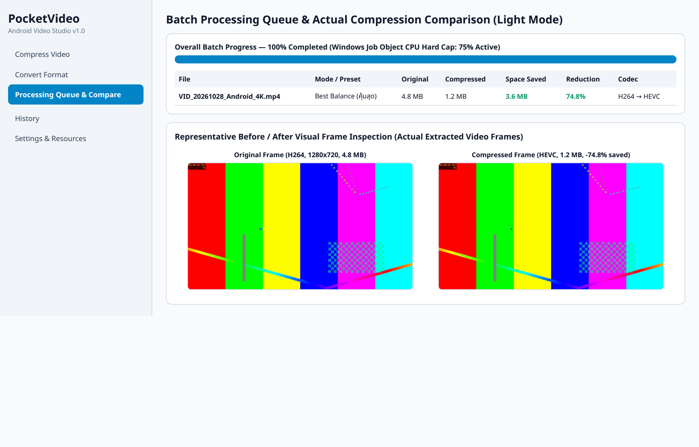

# PocketVideo — Open-Source Windows Video Compressor & Converter

**PocketVideo** is a free, open-source, 100% offline Windows 10/11 (x64) desktop application for compressing large video files recorded on Android phones and converting between media formats while preserving visible image quality.

> **Screenshot status:** The previews below were generated with a headless HTML renderer using actual FFmpeg test data. They illustrate the intended layout; they are **not** native Windows/PySide6 screenshots. Each Windows CI build also captures native Qt screenshots as a downloadable workflow artifact for review.





## Key Features

### 1. Five Simple Compression Modes (No Codec Jargon Required)
Default interface language is **Thai (`th`)** with one-click switching to **English (`en`)** and **Dark / Light** themes:

| Preset | Thai Name | English Name | Encoding Strategy & Priority |
| :--- | :--- | :--- | :--- |
| **Preset A** | **เน้นภาพสวย** | **Best Picture Quality** | Software CRF (`slow`, CRF 20 HEVC / 18 H.264) prioritizing visual fidelity. |
| **Preset B (Default)** | **คุ้มสุด** | **Best Balance** | Software CRF (`medium`, CRF 24 HEVC / 22 H.264) recommended for Android phone videos. |
| **Preset C** | **ประหยัดพื้นที่สุด** | **Maximum Space Saving** | High-density CRF (`slow`, CRF 29 HEVC / 27 H.264) with visual degradation warnings. |
| **Preset D** | **เร็วสุด** | **Fastest Compression** | Hardware GPU encoding (`NVENC`, `QSV`, `AMF`) with automatic fast CPU fallback (`veryfast`). |
| **Preset E** | **กำหนดขนาดเอง** | **Custom Target File Size** | Genuine **two-pass** software encoding (`libx264` / `libx265`) targeting user-specified MB/GB after reserving audio, subtitles, and container overhead. |

> **Important**: Presets describe encoding priorities rather than guaranteed percentage reductions. Actual savings depend on source motion complexity, codec, and bitrate. PocketVideo never mixes conflicting CRF and two-pass bitrate flags.

### 2. Android Phone Video Optimization
- **Intelligent FFprobe Inspection**: Detects MP4/MOV/MKV/AVI/WebM containers, H.264/AVC, H.265/HEVC, VP9, AV1, 4K resolution, 30/60 FPS, Variable Frame Rate (`-fps_mode vfr`), portrait/landscape rotation metadata, 8-bit/10-bit pixel formats, and Android device tags (`com.android.manufacturer`, `com.android.model`).
- **Two Compatibility Modes**:
  1. **Modern Android**: Prioritizes H.265/HEVC (`hvc1` tag) for maximum storage savings on modern devices.
  2. **Maximum Compatibility**: Prioritizes H.264/AAC in MP4 (`+faststart`) for universal playback.
- **HDR10, HLG & Dolby Vision Safety**:
  - Preserves 10-bit `yuv420p10le` and `bt2020` / `smpte2084` / `arib-std-b67` color transfer characteristics when supported.
  - Never silently converts HDR to SDR without warning.
  - Detects **Dolby Vision** (`dovi` configuration record / `dvhe` / `dvh1`) and explicitly warns that re-encoding cannot guarantee proprietary Dolby Vision RPU preservation, offering HDR10 fallback or lossless stream copy.
- **Already-Efficient Detection**: Calculates source bits-per-pixel-per-frame (`bpp`) and warns when recompressing an already tightly encoded video offers minimal benefit.

### 3. Smart Lossless Remux vs. Full Transcoding
- Supports **MP4**, **MOV**, **MKV**, **AVI**, and **WebM**.
- **Smart Remux (`-c:v copy -c:a copy`)**: When existing video/audio streams are natively compatible with the target container, PocketVideo changes the container in seconds with zero quality loss.
- Clearly distinguishes **Fast Lossless Smart Remux**, **Full Transcoding**, and **Compression with Re-encoding**.

### 4. Genuine Windows Resource Management (`Job Objects`)
- **Simple Modes**: **Light** (40% CPU cap, `IDLE` priority), **Balanced** (75% CPU cap, `BELOW_NORMAL` priority), and **Maximum** (100% uncapped, `NORMAL` priority).
- **Enforceable Windows CPU Hard Cap**: Uses Win32 `CreateJobObjectW` and `SetInformationJobObject` with `JobObjectCpuRateControlInformation` (`JOB_OBJECT_CPU_RATE_CONTROL_ENABLE | JOB_OBJECT_CPU_RATE_CONTROL_HARD_CAP`) to enforce a true kernel-level CPU percentage limit on child `ffmpeg.exe` processes.
- **Honest Resource Controls**: Clearly distinguishes kernel-enforced hard limits (Windows Job Object CPU Rate Control) from best-effort controls (FFmpeg `-threads`, CPU affinity mask, GPU encoder selection, and queue concurrency).

### 5. Safety, Reliability & Visual Comparison
- **Never Overwrites Originals**: Writes to temporary `.pocketvideo_tmp_*` files in a separate output directory, verifies output stream integrity and duration via `ffprobe` after encoding, and atomically moves the verified file into place.
- **Before/After Visual Comparison & Sample Preview**: Extracts representative video frames and generates a 2.5-second compressed sample clip so you can inspect fine detail before encoding a multi-gigabyte video.

## Installation (Windows 10/11 x64)

1. **Installer (`PocketVideo-Setup-1.0.0-win64.exe`)**:
   Download the installer from the GitHub Releases page, verify its SHA-256 hash against `SHA256SUMS.txt`, and run the setup wizard. `ffmpeg.exe` and `ffprobe.exe` are bundled inside—no external installation or internet connection is required.
2. **Portable Package (`PocketVideo-1.0.0-win64-portable.zip`)**:
   Extract the ZIP archive anywhere on your computer and run `PocketVideo.exe`.

## Reproducible Build Instructions (From Source)

### Prerequisites (Windows 10/11 x64)
- Python 3.12+
- Git
- Optional: [Inno Setup 6](https://jrsoftware.org/isinfo.php) (`iscc.exe` in `PATH` to compile the `.exe` installer)

### Step-by-Step Build
```powershell
git clone https://github.com/Apichetfirm/PocketVideo.git
cd PocketVideo

# 1. Create virtual environment and install dependencies
python -m venv .venv
.\.venv\Scripts\Activate.ps1
pip install -r requirements-dev.txt
pip install -e .

# 2. Run the automated build, test, FFmpeg SHA-256 verification, and packaging script
.\packaging\build_windows.ps1
```

All build outputs (`PocketVideo-Setup-1.0.0-win64.exe`, `PocketVideo-1.0.0-win64-portable.zip`, and `SHA256SUMS.txt`) are placed in `dist\release\`.

## Running Automated Tests
```bash
PYTHONPATH=src python3 -m unittest discover -s tests -v
```

## Documentation
- [User Guide (Thai & English)](docs/USER_GUIDE.md)
- [Technical Architecture](docs/ARCHITECTURE.md)
- [Third-Party License Notices](THIRD_PARTY_NOTICES.md)
- [Release Notes](RELEASE_NOTES.md)

## License
PocketVideo is free and open-source software licensed under the **GNU General Public License v3.0 or later (`GPL-3.0-or-later`)**. See [LICENSE](LICENSE) and [THIRD_PARTY_NOTICES.md](THIRD_PARTY_NOTICES.md) for full details.
